# AI Operations & Inventory Agent

A guarded AI operations agent for industrial product, inventory, quotation, and support workflows built with **Python, FastAPI, SQLite, Model Context Protocol (MCP), and OpenAI Codex**.

The project demonstrates an end-to-end agentic architecture in which Codex selects custom MCP tools to retrieve live business data and perform controlled write actions through a tested REST API. Write operations use a two-stage **prepare → human confirmation → execute** flow with short-lived, action-bound, single-use confirmation tokens, audit logging, and webhook delivery.

> **Portfolio note:** The data in this repository is fictional sample data for demonstration. This project is not affiliated with or deployed by any specific employer or customer.

## Engineering validation

- ✅ **23/23** automated regression tests passing
- ✅ **86%** application test coverage
- ✅ **8/8** automated read-only agent evaluations passing
- ✅ **7/7** manual guarded-write evaluations passing
- ✅ **15/15** total agent evaluation scenarios passing
- ✅ **9 MCP tools** exposed to the agent
- ✅ Human-in-the-loop protection for write operations
- ✅ Audit trail and webhook delivery/failure handling

## Architecture

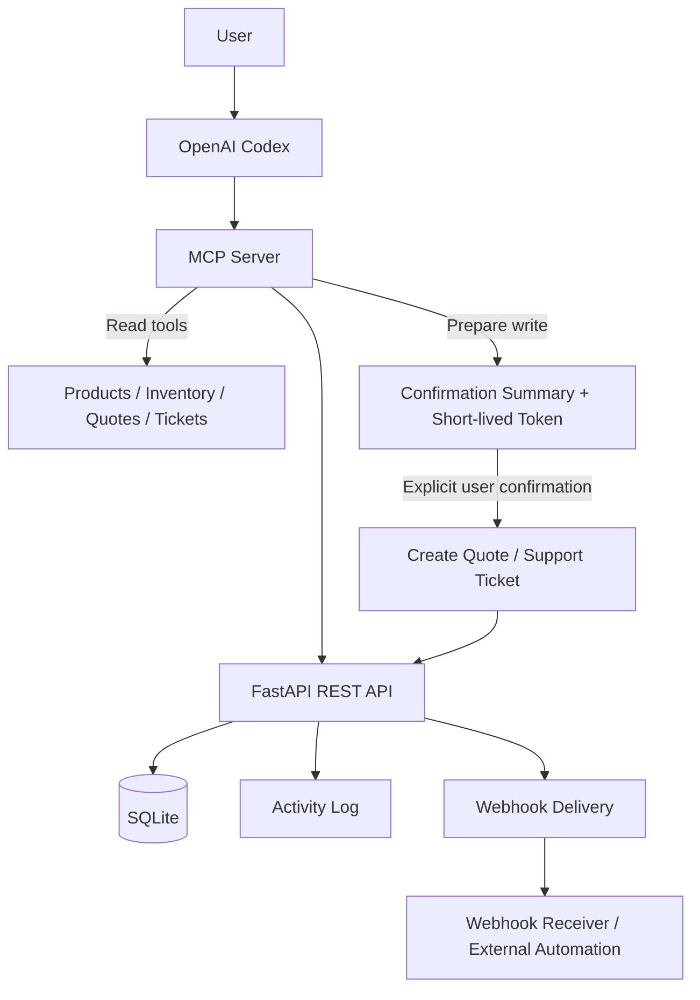

For a deeper walkthrough, see [docs/architecture.md](docs/architecture.md).

## REST API

The FastAPI service exposes product, inventory, quote, support-ticket, activity, and webhook operations.

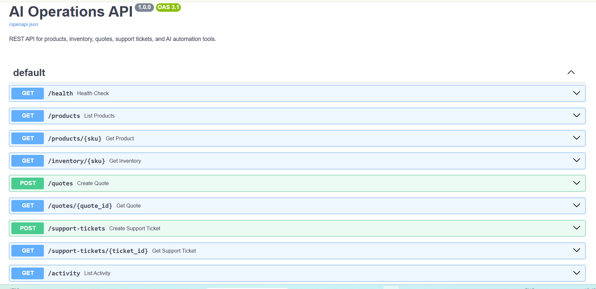

Core endpoints:

| Method | Endpoint | Purpose |
|---|---|---|
| `GET` | `/health` | Service health check |
| `GET` | `/products` | Search/filter products |
| `GET` | `/products/{sku}` | Product details |
| `GET` | `/inventory/{sku}` | Current inventory |
| `POST` | `/quotes` | Create a draft quote |
| `GET` | `/quotes/{quote_id}` | Retrieve a quote |
| `POST` | `/support-tickets` | Create a support ticket |
| `GET` | `/support-tickets/{ticket_id}` | Retrieve a support ticket |
| `GET` | `/activity` | Inspect audit/activity events |
| `POST` | `/webhooks/activity` | Receive business events |

See [docs/api-guide.md](docs/api-guide.md) for examples and validation behavior.

## MCP tools

The MCP server exposes **9 tools**. Five are read-only; four implement guarded write workflows.

### Read-only tools

- `search_products`
- `get_product_details`
- `check_inventory`
- `get_quote`
- `get_support_ticket`

### Guarded write tools

- `prepare_quote_draft`
- `create_quote_draft`
- `prepare_support_ticket`
- `create_support_ticket`

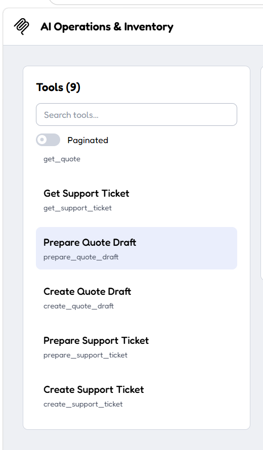

The write tools are intentionally split into two steps. A prepare tool validates the request and returns a human-readable summary plus a short-lived token. The final create tool requires that token and cannot bypass the confirmation path.

## Natural-language tool use

Codex can choose multiple MCP tools from a normal business question. In this example it retrieves both product details and live inventory for `PRX-001`.

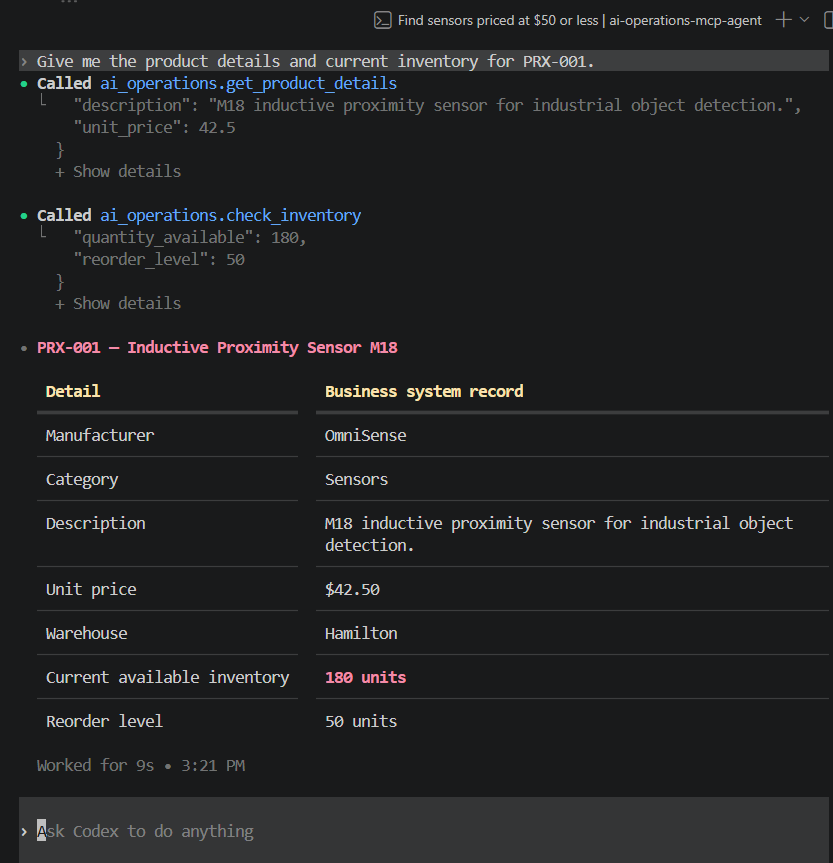

The agent is also instructed not to invent missing business data. An invalid SKU produces a controlled tool failure instead of a fabricated inventory quantity.

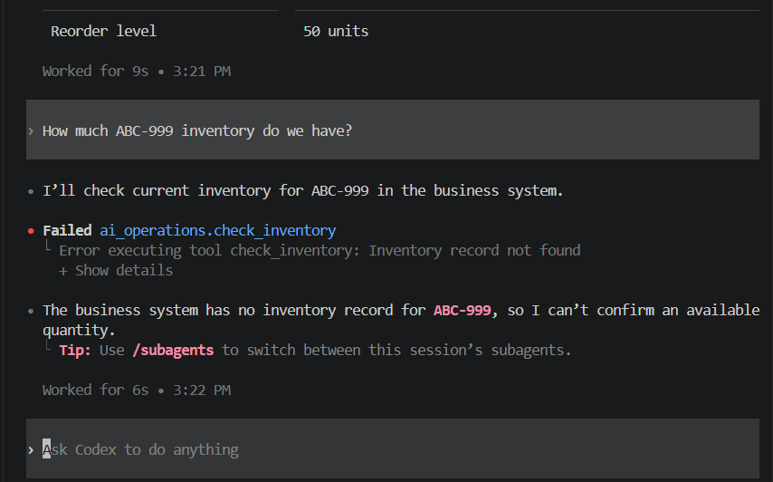

## Human-in-the-loop writes

A quote request first calls `prepare_quote_draft`. The agent presents the validated summary and asks for explicit confirmation before performing the write.

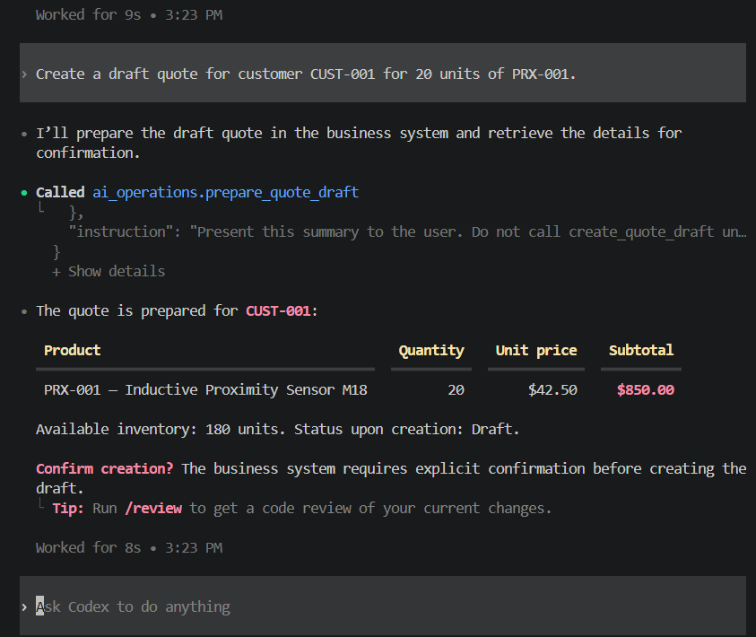

Only after confirmation does Codex call `create_quote_draft` and return the created quote ID.

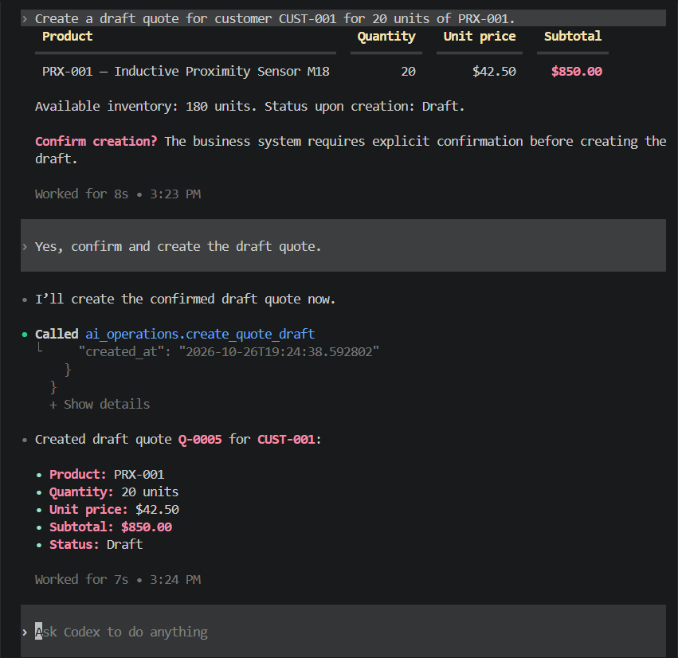

The same prepare/confirm/execute pattern is used for support tickets.

## Audit trail and webhooks

Business writes generate activity events and asynchronous webhook delivery records. External-delivery failure is isolated from the primary transaction and recorded rather than silently lost.

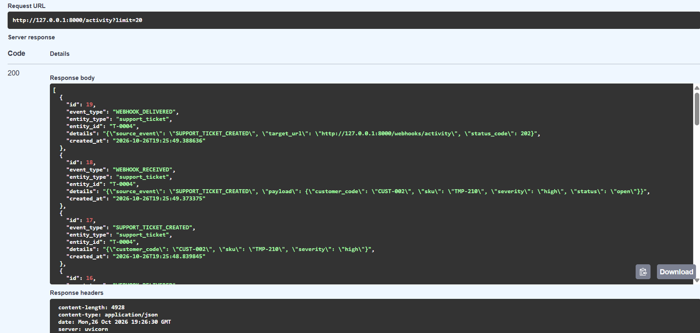

## Testing and evaluation

The application has a pytest regression suite covering products, inventory, quotes, support tickets, webhooks, activity logging, validation, and MCP registration.

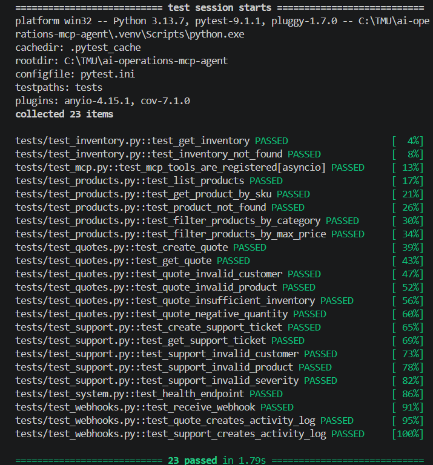

Current application coverage is **86%**.

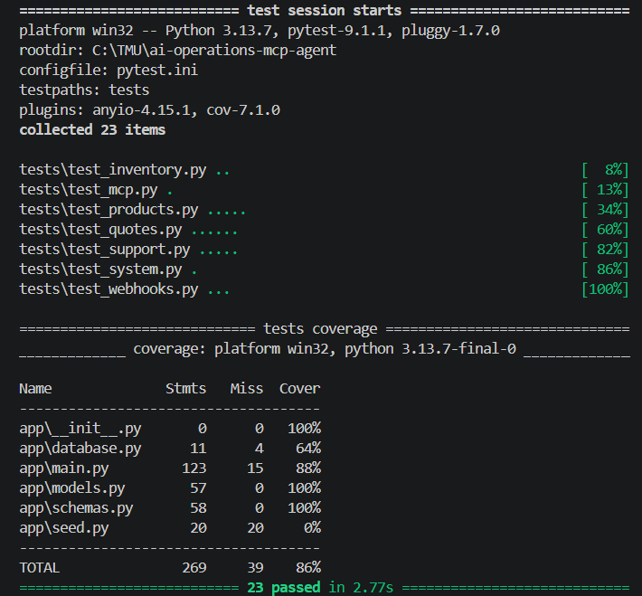

The Codex evaluation suite also validates tool selection and no-hallucination behavior for read operations.

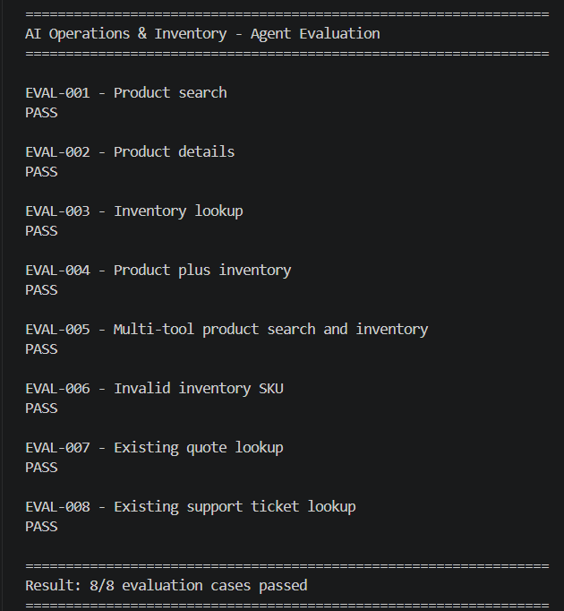

Manual guarded-write evaluation covers confirmation, cancellation, invalid SKUs, and insufficient inventory. All **7/7** scenarios passed.

See [docs/testing-and-evaluation.md](docs/testing-and-evaluation.md).

## Tech stack

- Python 3.13
- FastAPI
- SQLAlchemy
- SQLite
- Pydantic
- HTTPX
- REST / JSON
- Webhooks
- Model Context Protocol (MCP)
- OpenAI Codex
- pytest / pytest-cov
- Git / GitHub

## Local setup

### 1. Clone and create a virtual environment

```bash
git clone <your-repository-url>
cd ai-operations-mcp-agent
python -m venv .venv
```

Windows PowerShell:

```powershell
.venv\Scripts\Activate.ps1
```

### 2. Install dependencies

```bash
pip install -r requirements.txt
```

### 3. Configure environment variables

Copy `.env.example` to `.env` and keep local values private.

```env
APP_ENV=development
API_BASE_URL=http://127.0.0.1:8000
WEBHOOK_URL=http://127.0.0.1:8000/webhooks/activity
```

### 4. Seed the local sample database

```bash
python -m app.seed
```

### 5. Start FastAPI

```bash
uvicorn app.main:app --reload
```

Swagger UI:

```text
http://127.0.0.1:8000/docs
```

### 6. Inspect MCP locally

With Node.js, `npx`, `uv`, and the Python MCP package installed:

```bash
mcp dev mcp_server/server.py
```

### 7. Register the MCP server with Codex

Use your local Python interpreter and server path:

```text
codex mcp add ai_operations -- <python-executable> <path-to-mcp_server/server.py>
```

Then start Codex from the repository and verify the server with `/mcp`.

See [docs/setup-guide.md](docs/setup-guide.md) and [docs/mcp-guide.md](docs/mcp-guide.md) for detailed instructions.

## Security and guardrails

The project intentionally separates read tools from state-changing actions. Key controls include:

- read-only MCP annotations for retrieval tools
- explicit prepare/execute separation for writes
- short-lived confirmation tokens
- single-use confirmation tokens
- action-bound tokens that cannot authorize a different operation
- validation of SKUs, customer codes, quantity, severity, and inventory availability
- controlled `ToolError` responses instead of raw tracebacks
- `.env`, local SQLite files, virtual environments, raw eval traces, and coverage artifacts excluded from Git
- audit events for quote and support-ticket creation
- webhook delivery success/failure logging

See [SECURITY.md](SECURITY.md) and [docs/security-and-guardrails.md](docs/security-and-guardrails.md).

## Repository guide

```text
app/                         FastAPI, SQLAlchemy models, schemas, seed data
mcp_server/                  MCP server and tool definitions
tests/                       Automated regression tests
evals/                       Automated and manual agent evaluations
docs/                        Architecture, setup, API, MCP and portfolio docs
AGENTS.md                    Repository-level Codex behavior instructions
.env.example                 Safe local configuration template
pytest.ini                   Test configuration
requirements.txt             Python dependencies
```

## Portfolio summary

This project was built to demonstrate practical AI automation and agent integration beyond prompt-only chatbots: structured APIs, business validation, MCP tooling, human approvals, event delivery, automated tests, and repeatable agent evaluations.

Resume/LinkedIn/interview wording is available in [docs/portfolio-wording.md](docs/portfolio-wording.md).
