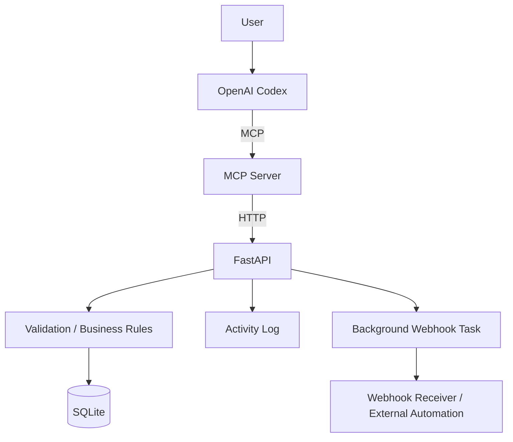
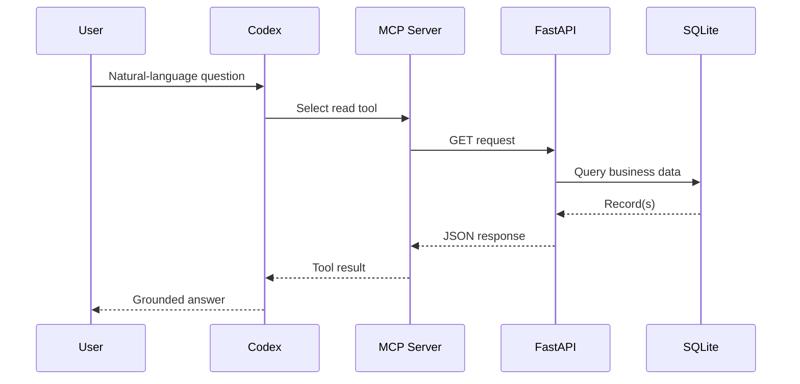
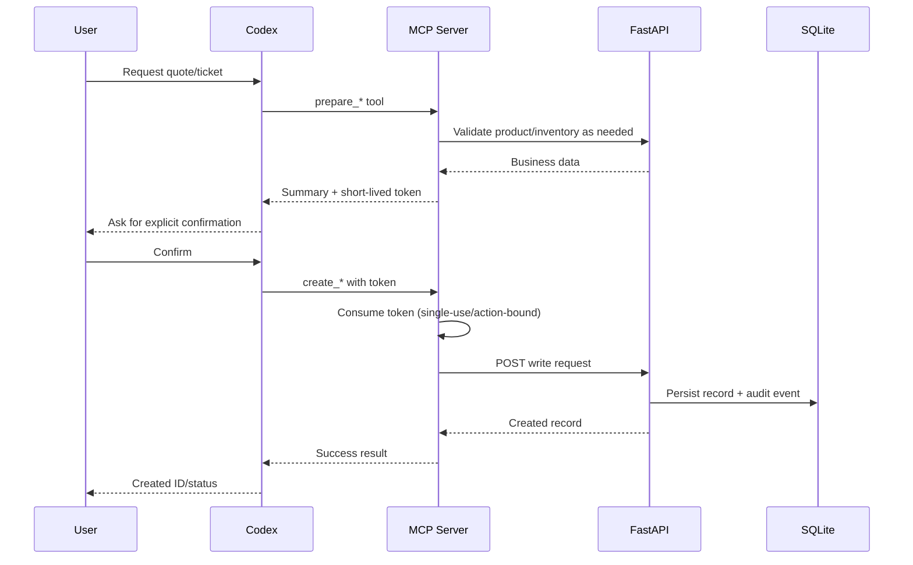

# Architecture

## Overview

The project separates natural-language reasoning, tool execution, business validation, persistence, and event delivery into distinct layers.

## Read path

## Guarded write path

## Design choices

- **FastAPI remains the business-system boundary.** MCP does not write directly to SQLite.
- **MCP is an adapter layer.** It translates model tool calls into validated REST operations.
- **Writes are intentionally two-step.** Preparation and execution are separate tools.
- **Audit events are first-class data.** Quote and support-ticket writes are traceable.
- **Webhook failures are isolated.** A delivery failure does not roll back a successful primary transaction.
- **Tests use an isolated SQLite database.** The real local database is not modified by regression tests.
